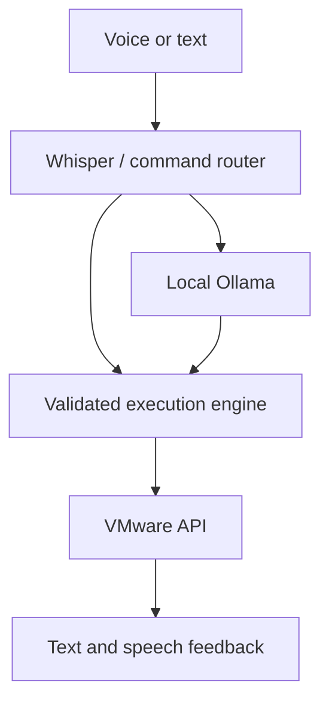

# NEXUS AI
Voice-controlled AI agent for infrastructure automation

**Development preview — v4.1 | VMware homelab**

NEXUS combines Turkish voice recognition, a local language model and VMware APIs to manage virtual infrastructure with explicit operator approval.

## Features
- Turkish speech recognition (faster-whisper), local text-to-speech
- Ollama / Qwen 2.5 command interpretation
- VMware inventory, VM creation, power-on and ISO discovery
- Background inventory cache with data age
- Explicit confirmation before infrastructure changes

## Architecture


## Setup (Windows)
Install Python and Ollama, then:
```powershell
python -m venv .venv
.\.venv\Scripts\python.exe -m pip install -r requirements.txt
ollama pull qwen2.5:7b
ollama create nexus -f Modelfile
.\.venv\Scripts\python.exe -c "from faster_whisper import WhisperModel; WhisperModel('small',device='cpu',compute_type='int8',download_root='models/whisper')"
$env:NEXUS_ESXI_HOST='your-esxi-host'
.\.venv\Scripts\python.exe nexus_agent.py
```
Use trusted TLS certificates. For isolated self-signed labs only, explicitly set NEXUS_INSECURE_TLS=1. Credentials are entered interactively. Adapt the prototype's datastore1 and datastore2/.iso assumptions and resource limits to your lab.

## Commands
/status, /iso, /refreshiso, /deploy, /create NAME CPU RAM_MB DISK_GB, /power NAME, /exit. Press Enter for voice input.

## Validation status
Inventory, VM creation, power-on and ISO discovery were demonstrated separately on ESXi 6.7. Intermittent API timeouts and authentication failures remain unresolved. Combined deployment and published configuration changes have not been live-tested. Guest OS installation is manual. Not production-ready.

## Roadmap
- [ ] Resolve API connection stability
- [ ] Improve voice latency and transcription
- [ ] Validate full deployment
- [ ] Modular configuration and automated tests
- [ ] Management UI and demo video

Never commit credentials, logs, private infrastructure details or model weights.
